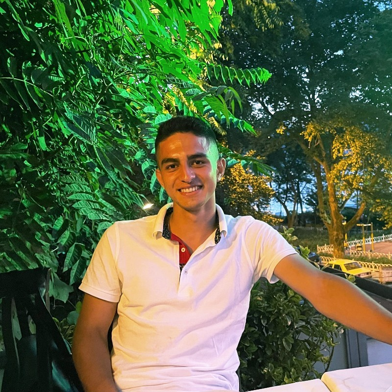

# Recep Ulaş Uzun

**M.Eng. AI for Smart Sensors & Actuators · THD Deggendorf · Erlangen, Germany**

I build things at the intersection of **computer vision, LLM systems, industrial AI, and embedded systems**. Currently pursuing my master's, after a B.Sc. in Computer Engineering on a full scholarship. Open to working student roles in Bayern.

---

## Featured Projects

| Project | Stack | Highlight |
|---|---|---|
| [**Medical AI Paper QA**](https://github.com/salamon30/rag-project) | RAG · ChromaDB · Cross-encoder · NVIDIA NIM | Cited answers or "I don't know" · reranker: right page 0.45 → 0.90 · 60-question eval, 72 tests in CI |
| [**In-Car Assistant Evaluation**](https://github.com/salamon30/car-assistant-eval) | LLM tool calling · Whisper · ffmpeg · NVIDIA NIM | 3 test levels from text to noisy speech, 270 runs · text tests catch 1 of 20 real bugs · prompt fix 86/90 → 90/90 |
| [**Low-Altitude Aerial Detection**](https://github.com/BUAksakal/low-altitude-aerial-detection) | YOLOv8 · PyTorch · CVAT | THI × Fraunhofer IVI × THD — 3–9m drone footage, custom dataset |
| [**Helmet Detection**](https://github.com/salamon30/helmet-detection) | YOLOv8s · Streamlit | 94.9% mAP@50 · real-time PPE compliance monitoring |
| [**Sensor Anomaly Detection**](https://github.com/salamon30/sensor-anomaly-detection) | Isolation Forest · scikit-learn | 95% F1 · unsupervised, no labels needed |
| [**Coil Cooling Digital Twin**](https://github.com/salamon30/cool-cooling) | Python · Streamlit · SciPy | Industry collab with Borçelik — live thermal simulation |
| [**Werkstudent Agent**](https://github.com/salamon30/werkstudent-agent) | Python · Claude API · BeautifulSoup | Daily job digest + AI-generated cover letters |

### Spotlight

<table>
  <tr>
    <td width="50%" valign="top">
      
       <b>In-car assistant, three test levels.</b> The same command as clean text, with simulated ASR errors, and as real speech with cabin noise. Text tests found 1 of 20 real bugs.
    </td>
    <td width="50%" valign="top">
      
       <b>RAG with measured steps.</b> Every stage was evaluated before the next; the reranker doubled right-page retrieval from 0.45 to 0.90.
    </td>
  </tr>
</table>

---

## Tech Stack

**Languages**

**AI / ML**

**LLM & Speech**

**Engineering**

**Data & Analytics**

**Web**

---

## Now

- **[Active]** Low-altitude drone object detection — custom dataset annotation + YOLOv8 fine-tuning (Fraunhofer IVI)
- **[Active]** Edge AI deployment experiments — running inference on embedded hardware
- **[Seeking]** Werkstudent position in AI / ML / Computer Vision — available immediately, Bayern preferred

**Recently shipped**
- **Nov 2026** · [car-assistant-eval](https://github.com/salamon30/car-assistant-eval) — multi-fidelity evaluation of an in-car LLM assistant: text, simulated ASR errors, real speech + noise + Whisper, budget strategies
- **Oct 2026** · [rag-project](https://github.com/salamon30/rag-project) — evaluated RAG pipeline over medical-AI papers: cited answers, reranker, held-out test set
- **Jun 2026** · [werkstudent-agent](https://github.com/salamon30/werkstudent-agent) — Claude-powered job search agent: daily digest email + AI cover letter generation

---

## Experience

| Company | Role | Year |
|---|---|---|
| Vodafone Türkiye | Data Science Intern | 2025 |
| KPMG Türkiye | Data Analyst & Digital Trainee | 2024–25 |
| McKinsey Forward Program | Problem-solving & Digital Strategy | 2023 |

---

## Beyond the Code

Turkish Junior Tennis Champion (2014) · 18+ years competitive experience · Currently playing at 1. FC Nürnberg · Coaching at FAU Erlangen-Nürnberg and University of Regensburg

---

Languages: Turkish 🇹🇷 · English 🇬🇧 · German 🇩🇪 (learning) · French 🇫🇷 (learning)
